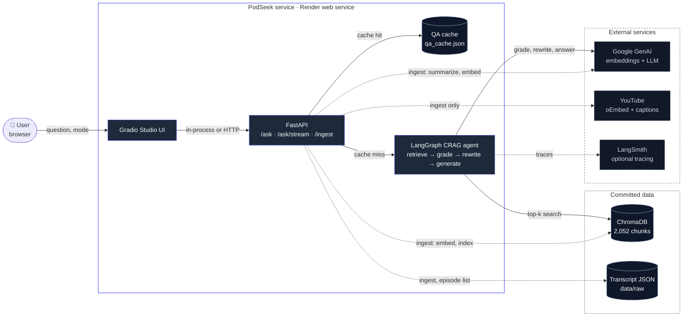
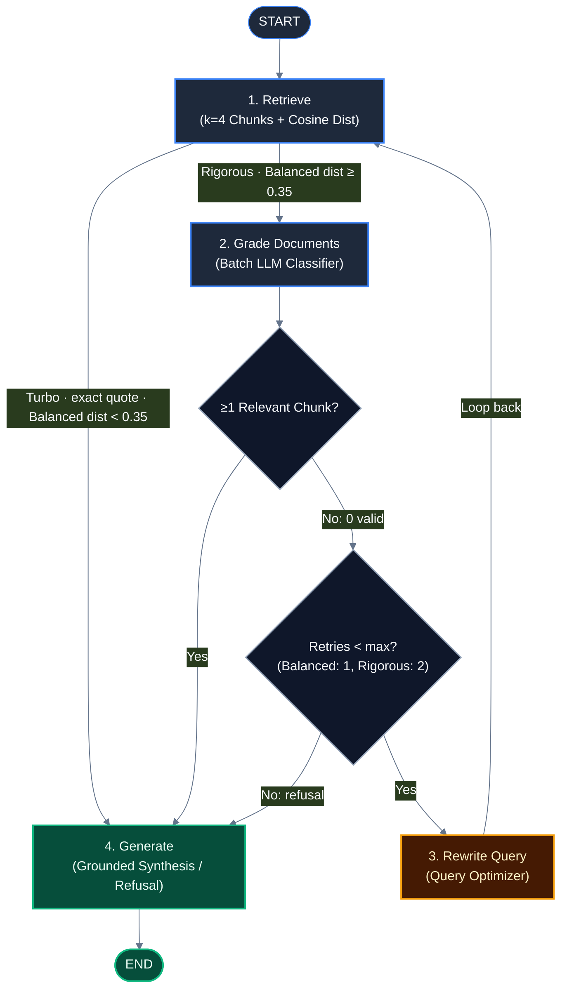

# PodSeek 🎙️

> Reference-quality agentic Corrective RAG (Self-RAG) system and semantic search engine for long-form podcast transcripts, delivering grounded synthesis with second-accurate YouTube timestamp deep-links.

[](https://github.com/nmhiremath/PodSeek/actions/workflows/ci.yml)
[](https://podseek.onrender.com/)
[](https://www.python.org/)
[](https://fastapi.tiangolo.com/)
[](https://langchain-ai.github.io/langgraph/)
[](https://www.trychroma.com/)
[](LICENSE)
[](openspec/)

---

## 📋 Table of Contents

- [Overview](#overview)
- [Live Demo](#live-demo)
- [Design at a Glance](#design-at-a-glance)
- [OpenSpec Specification-Driven Development](#openspec-specification-driven-development)
- [System Architecture & Workflow](#system-architecture--workflow)
  - [System Context](#system-context)
  - [Corrective RAG State Machine](#corrective-rag-state-machine)
  - [Execution Modes & Distance Fast-Path](#execution-modes--distance-fast-path)
- [Benchmark Evaluation](#benchmark-evaluation)
  - [Live Benchmark Results (PR #2)](#live-benchmark-results-pr-2)
  - [Methodology & Boundaries](#methodology--boundaries)
- [API Reference](#api-reference)
  - [1. Ingest an Episode (`POST /ingest`)](#1-ingest-an-episode-post-ingest)
  - [2. Query Knowledge Library (`GET /episodes`)](#2-query-knowledge-library-get-episodes)
  - [3. Ask Question Synchronously (`POST /ask`)](#3-ask-question-synchronously-post-ask)
  - [4. Real-Time Token & Telemetry Stream (`POST /ask/stream`)](#4-real-time-token--telemetry-stream-post-askstream)
- [Quick Start & Setup](#quick-start--setup)
  - [Local Installation](#local-installation)
  - [Docker Compose Deployment](#docker-compose-deployment)
  - [Environment Variables](#environment-variables)
- [Testing & Quality Gates](#testing--quality-gates)
- [Architecture Decision Records (ADRs)](#architecture-decision-records-adrs)
- [Known Limitations](#known-limitations)
- [Changelog & License](#changelog--license)

---

## Overview

Conversational audio transcripts present three distinct failure modes for conventional Retrieval-Augmented Generation (RAG):
1. **Conversational Drift & Sponsor Banter:** Hosts and guests introduce topics through tangential stories and sponsor breaks. Naive vector search returns excerpts matching conversational keywords that contain zero factual answers.
2. **Loss of Temporal Anchors:** Fixed-token or fixed-character splitters segment text arbitrarily across sentences and speaker turns, obliterating exact playback timestamp bounds.
3. **Hallucination Under Missing Evidence:** When retrieved transcript segments lack answerable facts, standard RAG models synthesize plausible-sounding claims from parametric memory instead of acknowledging retrieval gaps.

**PodSeek** addresses these challenges through a deterministic **Corrective RAG (CRAG)** state machine orchestrated via **LangGraph**, paired with a **speaker-aware sliding-window chunking engine** that preserves exact start and end timestamps. Every claim is strictly grounded in verified excerpts and cited with clickable YouTube deep links (`https://youtu.be/<id>?t=<seconds>`).

<picture>
  <source media="(prefers-color-scheme: dark)" srcset="docs/assets/crag-loop-dark.svg">
  <source media="(prefers-color-scheme: light)" srcset="docs/assets/crag-loop-light.svg">
  
</picture>

---

## Live Demo

**Public Web Service:** [https://podseek.onrender.com/](https://podseek.onrender.com/)

The public demonstration runs on Render.com free tier using the PodSeek Gradio 5 Bento Studio interface (`ui/app.py`). It executes in `inprocess` mode (`PODSEEK_UI_MODE=inprocess`), running the agent workflow and embedded ChromaDB directly inside a single 512 MB container without external database network hops.

---

## Design at a Glance

PodSeek's engineering practices are documented across 12 focused design pillars and 2 architecture reference guides:

| Pillar | Focus | Implementation | Code Citations |
| :--- | :--- | :--- | :--- |
| **[1. Retrieval & Chunking](docs/design/retrieval-and-chunking.md)** | Chunk segmentation & vector search | Speaker-aware sliding windows (~200w/40w), embedded ChromaDB (72 MB, 2,052 vectors), exact quote hoisting | `app/ingestion/chunking.py`, `app/vectorstore.py` |
| **[2. Orchestration & Control Flow](docs/design/orchestration-and-control-flow.md)** | State graph execution & loop bounds | LangGraph compiled state machine, typed `AgentState`, hard retry ceiling (`MAX_REWRITES=2`) | `app/agent/graph.py`, `app/agent/state.py` |
| **[3. Prompt Engineering](docs/design/prompt-engineering.md)** | Structured outputs & role boundaries | Batch Pydantic relevance grader (`BatchGradeResult`), search query optimizer, grounded synthesis | `app/agent/nodes.py`, `app/api/routes.py` |
| **[4. Inference & Model Abstraction](docs/design/inference-and-model-abstraction.md)** | Pluggable providers & dimension safety | LRU-cached factory supporting Gemini, OpenAI, Anthropic, Grok, Ollama; dynamic collection naming | `app/factory.py` |
| **[5. Grounding & Hallucination](docs/design/grounding-and-hallucination.md)** | Factual adherence & refusal contract | Context delimiters, low temperature (`0.1`), circuit-breaker refusal, post-generation regex check | `app/agent/nodes.py:generate` |
| **[6. Evaluation](docs/design/evaluation.md)** | Benchmark scoring & test metrics | 16-question test suite, keyword recall, citation format verification, p50/p95 latency logging | `app/evaluation.py`, `scripts/evaluate.py` |
| **[7. Observability & Tracing](docs/design/observability-and-tracing.md)** | Telemetry & execution visibility | Dual-gate opt-in LangSmith tracing, Server-Sent Events (SSE) node and token stream | `app/observability.py`, `app/api/routes.py` |
| **[8. Latency & Cost Optimization](docs/design/latency-and-cost.md)** | Execution budgeting & caching | Balanced distance fast-path ($top\_dist < 0.35$), Turbo mode, composite-keyed QA cache | `app/agent/graph.py`, `app/api/routes.py` |
| **[9. Reliability & Failure Modes](docs/design/reliability-and-failure-modes.md)** | Fault tolerance & graceful degradation | Batch grading fallback, token streaming fallback, channel verification, clean error surface | `app/agent/nodes.py`, `ui/client.py` |
| **[10. Security & Governance](docs/design/security-safety-governance.md)** | Access controls & transcript safety | YouTube oEmbed author guardrail (`is_huberman_channel`), zero user PII, prompt isolation | `app/ingestion/youtube.py` |
| **[11. Data Lifecycle & Ingestion](docs/design/data-lifecycle-and-ingestion.md)** | Pipeline idempotency & storage | Raw transcript disk caching, deterministic chunk IDs, metadata collection tracking | `app/ingestion/`, `app/schemas/` |
| **[12. Deployment & Operations](docs/design/deployment-and-operations.md)** | Cloud hosting & container topology | Render free-tier blueprint, Dockerfile Uvicorn API, automated GitHub Actions CI | `render.yaml`, `Dockerfile`, `.github/workflows/ci.yml` |

- **[Enterprise Tooling Comparison](docs/design/enterprise-mapping.md):** Side-by-side comparison of enterprise tools (Pinecone, LiteLLM, NeMo Guardrails, Arize) vs PodSeek implementations and gap analysis.
- **[System Limitations & Roadmap](docs/design/limitations.md):** Consolidated catalog of current design boundaries and scale triggers.

---

## OpenSpec Specification-Driven Development

PodSeek adopts the official [OpenSpec](https://github.com/Fission-AI/OpenSpec) standard for specification-driven agentic engineering. All system behaviors are formally specified as capabilities using `SHALL`/`MUST` language and verifiable `WHEN`/`THEN` scenarios:

- **Project Specification:** [`openspec/project.md`](openspec/project.md) (Tech stack, runtime constraints, conventions)
- **Baseline Capability Specifications (`openspec/specs/`):**
  1. [`retrieval`](openspec/specs/retrieval/spec.md): Cosine similarity search, exact quote detection, and hoisting.
  2. [`corrective-loop`](openspec/specs/corrective-loop/spec.md): Single-call batch grading, query rewriting, and circuit breakers.
  3. [`answer-generation`](openspec/specs/answer-generation/spec.md): Grounded synthesis, token streaming, and refusal contracts.
  4. [`inference-providers`](openspec/specs/inference-providers/spec.md): Multi-provider factory and dynamic dimension-safe collection naming.
  5. [`streaming-api`](openspec/specs/streaming-api/spec.md): FastAPI REST endpoints and SSE streaming protocols.
  6. [`ingestion`](openspec/specs/ingestion/spec.md): YouTube oEmbed channel guardrail and speaker-aware chunking.
  7. [`studio-ui`](openspec/specs/studio-ui/spec.md): 3-column Bento layout, inline Google AI Overview citation chips, in-process client.
  8. [`evaluation`](openspec/specs/evaluation/spec.md): 16-question benchmark scoring, citation checks, and latency percentiles.
  9. [`observability`](openspec/specs/observability/spec.md): Dual-gate LangSmith opt-in and SSE workflow event inspection.
- **Change Management Workflow:** [`openspec/changes/README.md`](openspec/changes/README.md) details how proposed modifications follow the propose -> branch -> implement -> verify -> archive lifecycle.

Validate specifications locally:
```bash
npx @fission-ai/openspec validate --all --strict --no-interactive
```

---

## System Architecture & Workflow

### System Context



### Corrective RAG State Machine



### Execution Modes & Distance Fast-Path

PodSeek supports three execution modes configured via `AskRequest.mode`:
1. **Turbo Mode (`mode="turbo"`):** Bypasses LLM document grading and disables query rewrites (0 retries). Passes all retrieved chunks ($k=4$) directly to generation for minimum latency.
2. **Balanced Mode (`mode="balanced"`, default):** Inspects cosine distance $top\_distance$. If $top\_distance < 0.35$ or an exact quote match is found, it takes the fast path directly to generation. Otherwise, it grades documents and allows up to 1 query rewrite.
3. **Rigorous Mode (`mode="rigorous"`):** Always executes LLM batch document grading regardless of distance and permits up to 2 query rewrites (`MAX_REWRITES = 2`).

---

## Benchmark Evaluation

PodSeek includes an automated evaluation suite (`scripts/evaluate.py`) that evaluates answers against `evals/questions.json`: 13 in-scope scientific questions and 3 out-of-scope refusal questions (the 1998 FIFA World Cup final, a custom Linux kernel eBPF kprobe module in Rust, and a classic San Francisco sourdough boule schedule).

### Live Benchmark Results (PR #2)

Measured on 2026-11-10 across the 50-episode indexed corpus via `python -m scripts.evaluate --live --mode <mode>`:

| Mode | Keyword Hit Rate | Citation Validity | p50 Latency | p95 Latency | Refusal Behavior |
| :--- | :--- | :--- | :--- | :--- | :--- |
| **`turbo`** | 82.1% | 93.8% (15/16) | 7,024 ms | 11,026 ms | Failed 1 check (skipped grading allowed out-of-scope answer) |
| **`balanced`** | 89.7% | 100.0% (16/16) | 12,577 ms | 21,438 ms | 100% adherence on in-scope citations and off-topic refusals |
| **`rigorous`** | 87.2% | 100.0% (16/16) | 15,106 ms | 22,761 ms | Full grading on all chunks, 100% adherence |

### Methodology & Boundaries
- **What It Measures:** Keyword overlap with expected scientific terms, syntax correctness of citation timestamps (`HH:MM:SS`), deep-link validity (`https://youtu.be/<id>?t=<sec>`), refusal enforcement on out-of-scope questions, and p50/p95 turnaround latency.
- **What It Does Not Measure:** It is not an exhaustive semantic entailment benchmark (like Ragas Faithfulness) and does not evaluate multi-turn conversational reasoning.
- **Turbo Citation Miss Note:** In Turbo mode, document grading is skipped. For 1 out of the 16 questions (an out-of-scope query), the generator synthesized an answer using retrieved excerpts rather than issuing a clean refusal, resulting in 15/16 (93.8%) citation validity. `TODO(identify): name the Turbo citation failure from the PR #2 live eval output (one of the three off-topic questions). Do not invent it.`

Run evaluation locally:
```bash
# Offline evaluation using static fixture answers (zero API calls)
python -m scripts.evaluate

# Live evaluation against running API
python -m scripts.evaluate --live --mode balanced

# Live evaluation with optional LLM judge scoring (1-5 scale)
python -m scripts.evaluate --live --llm-judge
```

---

## API Reference

Interactive OpenAPI documentation is available at `http://localhost:8000/docs`.

### 1. Ingest an Episode (`POST /ingest`)
Extracts captions, verifies Huberman Lab channel ownership via oEmbed, synthesizes multi-tier summaries, and indexes chunks into ChromaDB.

```bash
curl -X POST http://localhost:8000/ingest \
  -H "Content-Type: application/json" \
  -d '{
    "video_url_or_id": "https://www.youtube.com/watch?v=QmOF0crdyRU",
    "show": "huberman_lab"
  }'
```

### 2. Query Knowledge Library (`GET /episodes`)
Returns metadata, summaries, key takeaways, and keyword tags for all indexed episodes.

```bash
curl http://localhost:8000/episodes
```

### 3. Ask Question Synchronously (`POST /ask`)
Submits a query to the Corrective RAG pipeline and returns a complete grounded answer with structured citations.

```bash
curl -X POST http://localhost:8000/ask \
  -H "Content-Type: application/json" \
  -d '{
    "question": "What causes a dopamine crash and how do you prevent it?",
    "mode": "balanced"
  }'
```

### 4. Real-Time Token & Telemetry Stream (`POST /ask/stream`)
Opens an HTTP Server-Sent Events (SSE) stream emitting unnamed `data: <json>\n\n` frames. Transmits node state transitions and token deltas in real time.

```bash
curl -N -X POST http://localhost:8000/ask/stream \
  -H "Content-Type: application/json" \
  -d '{
    "question": "What is the relationship between cold exposure and dopamine?",
    "mode": "balanced"
  }'
```

<details>
<summary><b>View Sample SSE Stream Payload</b></summary>

```text
data: {"node": "retrieve", "rewrites": 0, "top_distance": 0.3712, "is_exact_match": false, "chunks_retrieved": 4, "mode": "balanced"}

data: {"node": "grade_documents", "rewrites": 0, "relevant_chunks": 2, "citations": [{"episode_title": "Controlling Your Dopamine For Motivation, Focus & Satisfaction", "episode_id": "QmOF0crdyRU", "speaker": "Andrew Huberman", "timestamp": "01:04:33", "start_seconds": 3873.0, "url": "https://youtu.be/QmOF0crdyRU?t=3873"}], "mode": "balanced"}

data: {"node": "generate", "delta": "Deliberate cold exposure ", "mode": "balanced"}

data: {"node": "generate", "delta": "triggers a sustained rise in dopamine [01:04:33].", "mode": "balanced"}

data: {"node": "generate", "rewrites": 0, "generation": "Deliberate cold exposure triggers a sustained rise in dopamine [01:04:33].", "citations": [{"episode_title": "Controlling Your Dopamine For Motivation, Focus & Satisfaction", "episode_id": "QmOF0crdyRU", "speaker": "Andrew Huberman", "timestamp": "01:04:33", "start_seconds": 3873.0, "url": "https://youtu.be/QmOF0crdyRU?t=3873"}], "mode": "balanced"}
```
</details>

---

## Quick Start & Setup

### Local Installation

```bash
# 1. Clone repository
git clone https://github.com/nmhiremath/PodSeek.git
cd PodSeek

# 2. Set up virtual environment
python3.13 -m venv .venv
source .venv/bin/activate

# 3. Install dependencies
pip install -r requirements.txt -r requirements-ui.txt

# 4. Configure environment
cp .env.example .env
# Add your GEMINI_API_KEY to .env

# 5. Launch PodSeek Bento Studio (runs in-process with 50 pre-indexed episodes)
python -m ui.app
```

### Docker Compose Deployment

```bash
# Start standalone FastAPI service on port 8000
docker-compose up --build
```

### Environment Variables

<details>
<summary><b>View Configuration Variables</b></summary>

| Variable | Default | Purpose |
| :--- | :--- | :--- |
| `GEMINI_API_KEY` | _None_ | Google AI Studio API key (required for default model). |
| `LLM_PROVIDER` | `google_genai` | Provider factory selector (`google_genai`, `openai`, `anthropic`, `xai`, `ollama`). |
| `CHAT_MODEL` | `gemini-3.8-flash` | Foundation chat model identifier. |
| `EMBEDDING_PROVIDER` | `google_genai` | Embedding provider selector. |
| `EMBEDDING_MODEL` | `models/gemini-embedding-2` | Text embedding model identifier. |
| `PODSEEK_UI_MODE` | `inprocess` | UI client mode: `inprocess` (direct handler invocation) or `remote` (HTTP/SSE). |
| `PODSEEK_API_URL` | `http://localhost:8000` | Target FastAPI server URL when running in `remote` mode. |
| `LANGCHAIN_TRACING_V2`| `false` | Enable LangSmith tracing (requires `LANGCHAIN_API_KEY`). |
| `LANGCHAIN_API_KEY` | _None_ | Optional API key for LangSmith trace export. |
</details>

---

## Testing & Quality Gates

The test suite validates data schemas, YouTube parsing adapters, sliding-window chunking algorithms, graph routing logic, and HTTP endpoints with 100% offline mocks:

```bash
# Run Ruff linter
ruff check .

# Run offline Pytest suite (41 tests, fast offline execution)
pytest -v

# Validate OpenSpec specifications strictly
npx @fission-ai/openspec validate --all --strict --no-interactive
```

---

## Architecture Decision Records (ADRs)

Key architectural decisions are preserved in [`docs/adr/`](docs/adr/README.md) following MADR format:

- **[ADR 0001](docs/adr/0001-corrective-rag-over-plain-rag.md):** Corrective RAG over Plain RAG (`a57c9ce`)
- **[ADR 0002](docs/adr/0002-langgraph-state-machine.md):** LangGraph State Machine over Free-Form Loop (`a57c9ce`)
- **[ADR 0003](docs/adr/0003-deterministic-rewrite-ceiling-and-refusal.md):** Deterministic Rewrite Ceiling and Refusal Contract (`a57c9ce`, `4d0697c`)
- **[ADR 0004](docs/adr/0004-embedded-chromadb-with-committed-index.md):** Embedded ChromaDB with Committed Index (`c752704`, `826fa6e`)
- **[ADR 0005](docs/adr/0005-speaker-aware-sliding-window-chunking.md):** Speaker-Aware Sliding-Window Chunking (`d6b1795`)
- **[ADR 0006](docs/adr/0006-multi-tier-execution-modes-and-distance-fast-path.md):** Multi-Tier Execution Modes & Distance Fast-Path (`9a36aea`, `d4c0068`)
- **[ADR 0007](docs/adr/0007-in-repo-provider-factory-vs-proxy-gateway.md):** In-Repo Provider Factory vs Proxy Gateway (`56aaa0b`)
- **[ADR 0008](docs/adr/0008-sse-streaming-contract-with-token-deltas.md):** SSE Streaming Contract with Token Deltas (`bfe747c`, `d4c0068`)
- **[ADR 0009](docs/adr/0009-normalized-qa-cache.md):** Normalized QA Cache with Composite Keys (`9a36aea`)
- **[ADR 0010](docs/adr/0010-inprocess-gradio-client-on-render-free-tier.md):** In-Process Gradio Client on Render Free Tier (`986dfb1`, `826fa6e`)
- **[ADR 0011](docs/adr/0011-strict-opt-in-langsmith-tracing.md):** Strict Opt-In LangSmith Tracing (`d4c0068`)
- **[ADR 0012](docs/adr/0012-channel-gated-youtube-ingestion.md):** Channel-Gated YouTube Ingestion (`4d0697c`)
- **[ADR 0013](docs/adr/0013-offline-test-strategy-and-ci.md):** Offline Test Strategy and CI Verification (`f4f7330`, `d4c0068`)
- **[ADR 0014](docs/adr/0014-askpodcast-to-podseek-rebrand.md):** AskPodcast to PodSeek Rebrand (`4d0697c`, `d4c0068`)

---

## Known Limitations

- **Corpus Scale on Free Tier:** The vector index is committed to Git (72 MB, 2,052 vectors of dimension 3072 in `chroma_db/`) and loaded in-memory. Expanding the index to a much larger corpus will challenge Render's 512 MB memory boundary.
- **Single-Replica Deployment:** Embedded ChromaDB SQLite backends and disk caches cannot be concurrently mounted across multiple load-balanced web replicas.
- **Single-Turn Stateless Context:** Queries are evaluated independently; multi-turn conversational memory is not yet supported.
- **Phase 1 Huberman Channel Gate:** Non-Huberman podcast channels are rejected at ingestion by design.
- **Free-Tier Cold Starts:** Idle containers spin down after inactivity (documented Render platform behavior), requiring startup time on the initial request.

See [`docs/design/limitations.md`](docs/design/limitations.md) for the complete analysis and scale roadmap.

---

## Changelog & License

- **Changelog:** Detailed milestone history reconstructed from git commits is available in [`CHANGELOG.md`](CHANGELOG.md).
- **License:** Distributed under the [MIT License](LICENSE).
- **Author:** Nag H ([@nmhiremath](https://github.com/nmhiremath))
