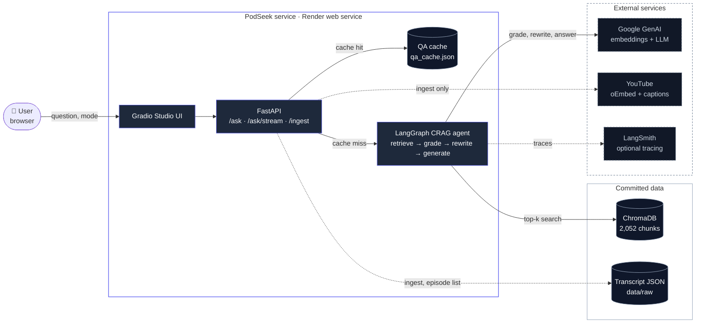

# PodSeek System Design Hub

Welcome to the architectural design documentation for PodSeek. This documentation analyzes each core pillar of agentic system design, contrasting PodSeek's minimalist, high-leverage implementation against large-scale enterprise patterns.

Every pillar document follows an identical 8-part structure: definition, implementation with code citations, enterprise approach, scale rationale, failure triggers, trade-offs accepted, historical pitfalls with commit hashes, and candidate OpenSpec changes.

---

## System Context

---

## Architecture Pillars

| Pillar | Focus | Implementation | Code Citations |
| :--- | :--- | :--- | :--- |
| [1. Retrieval & Chunking](retrieval-and-chunking.md) | Ingestion splitting & vector retrieval | Speaker-aware sliding windows, ChromaDB cosine search, exact phrase hoisting | `app/ingestion/chunking.py`, `app/vectorstore.py`, `app/agent/nodes.py` |
| [2. Orchestration & Control Flow](orchestration-and-control-flow.md) | State management & graph execution | LangGraph state machine, typed state, bounded conditional routing | `app/agent/graph.py`, `app/agent/state.py` |
| [3. Prompt Engineering](prompt-engineering.md) | Structured outputs & prompt boundaries | Batch Pydantic relevance grading, search rewriter, citation synthesis | `app/agent/nodes.py`, `app/api/routes.py` |
| [4. Inference & Model Abstraction](inference-and-model-abstraction.md) | Provider portability & dimension safety | LRU-cached factory supporting Google, OpenAI, Anthropic, xAI, Ollama | `app/factory.py` |
| [5. Grounding & Hallucination Control](grounding-and-hallucination.md) | Truthfulness & refusal enforcement | Grounded context formatting, circuit-breaker refusal, post-generation checks | `app/agent/nodes.py` |
| [6. Evaluation](evaluation.md) | Benchmark scoring & test metrics | 16-question offline/live harness, keyword hit rate, citation format validation | `app/evaluation.py`, `scripts/evaluate.py`, `evals/questions.json` |
| [7. Observability & Tracing](observability-and-tracing.md) | Execution telemetry & stream events | Strict opt-in LangSmith tracing, SSE node transition and token delta frames | `app/observability.py`, `app/api/routes.py` |
| [8. Latency & Cost Optimization](latency-and-cost.md) | Execution budgeting & caching | Balanced distance fast-path, Turbo mode, composite-keyed QA cache | `app/agent/graph.py`, `app/api/routes.py` |
| [9. Reliability & Failure Modes](reliability-and-failure-modes.md) | Resilience & graceful degradation | Batch grading fallback, token streaming try/except, channel validation | `app/agent/nodes.py`, `app/api/routes.py` |
| [10. Security, Safety & Governance](security-safety-governance.md) | Boundaries & transcript safety | YouTube oEmbed channel guardrail, strict read-only context, zero PII | `app/ingestion/youtube.py`, `app/api/routes.py` |
| [11. Data Lifecycle & Ingestion](data-lifecycle-and-ingestion.md) | Pipeline idempotency & storage | Raw transcript caching, chunk metadata generation, re-indexing story | `app/ingestion/`, `app/schemas/transcripts.py` |
| [12. Deployment & Operations](deployment-and-operations.md) | Containerization & free-tier hosting | Render in-process web service, Docker API image, automated GitHub CI | `render.yaml`, `Dockerfile`, `.github/workflows/ci.yml` |

---

## Architectural Reference Tables

- **[Enterprise Mapping Matrix](enterprise-mapping.md):** Side-by-side comparison of typical enterprise tooling (Pinecone, LiteLLM, NeMo Guardrails, Arize, Datadog) vs PodSeek's equivalent implementations and honest gap analysis.
- **[System Limitations & Scale Roadmap](limitations.md):** Consolidated catalog of current design boundaries and what components would be added at enterprise scale.
