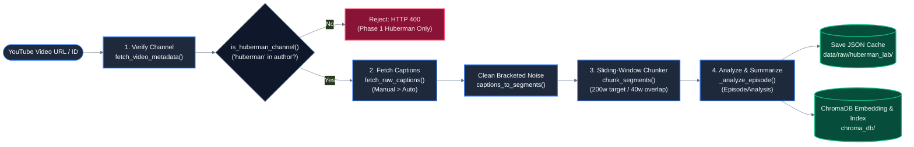

# Pillar 11: Data Lifecycle & Ingestion

## 1. What This Pillar Means in Production AI Systems
The data lifecycle and ingestion pipeline governs the ingestion, transformation, deduplication, indexing, and lifecycle management of knowledge corpora. In production AI systems, ingestion pipelines must be idempotent, resilient to schema migrations, maintain clear data provenance, and provide deterministic re-indexing capabilities when models or chunking parameters change.

## 2. What PodSeek Does
PodSeek implements a four-stage ingestion pipeline accessible via CLI or REST API:

1. **Verification & Extraction (`app/ingestion/youtube.py`):** Parses the 11-character YouTube video ID (`extract_video_id`), fetches video metadata and author via oEmbed (`fetch_video_metadata`), and gates channel access (`is_huberman_channel`).
2. **Caption Retrieval & Noise Removal (`app/ingestion/youtube.py`):** `fetch_raw_captions` queries the YouTube Transcript API, prioritizing manual English transcripts over auto-generated text. `captions_to_segments` strips non-speech audio noise matching `\[[^\]]*\]`.
3. **Chunking & Metadata Preserving (`app/ingestion/chunking.py`):** `chunk_segments` executes speaker-aware sliding-window chunking (200 words target, 40 words overlap), producing `Chunk` instances with unique deterministic IDs (`{episode_id}_c{chunk_index:04d}`).
4. **Structured Summarization & Indexing (`app/api/routes.py`, `app/vectorstore.py`):**
   - Synthesizes multi-tier summaries using `_analyze_episode` (`EpisodeAnalysis`).
   - Writes the raw transcript and metadata JSON to disk at `data/raw/huberman_lab/<episode_id>.json`.
   - Embeds and indexes chunks into ChromaDB via `index_chunks()`, recording the indexed collection name in the local JSON payload for tracking.

### Re-Indexing Story
If the embedding model or chunking logic changes:
- Raw caption transcripts are already cached on disk in `data/raw/huberman_lab/`. Re-indexing does not require re-fetching from YouTube.
- `scripts/index_and_search.py` or batch scripts can re-chunk and re-embed all cached episodes into a fresh ChromaDB collection name derived via `get_collection_name()`.

## 3. Enterprise Approach
At enterprise scale, organizations deploy:
- **Distributed Ingestion Orchestration:** Apache Airflow, Prefect, or Dagster pipelines orchestrating distributed tasks.
- **Message Queues & Stream Processing:** Apache Kafka or AWS SQS decoupling document arrival from ingestion workers.
- **Change Data Capture (CDC) & Zero-Downtime Re-Indexing:** Dual-writing to old and new vector collections (blue/green index deployment) before swapping index aliases without downtime.

## 4. Why We Didn't Need It Here, and How PodSeek Achieves the Same Intent
For a 50-episode curated podcast corpus:
- A straightforward batch script (`scripts/ingest_top_episodes.py`) or API endpoint (`POST /ingest`) completes ingestion in a single pass without Kafka or Airflow overhead.
- Disk caching in `data/raw/huberman_lab/` ensures complete reproducibility: all 50 episodes can be re-indexed offline without hitting YouTube rate limits.
- The `indexed_collections` metadata list tracks which collections contain chunks for each episode, ensuring idempotent ingestion.

## 5. Where Our Approach Breaks Down
PodSeek's ingestion architecture breaks down under the following triggers:
- **High-Frequency Ingestion Streams:** Processing hundreds of live podcasts daily would block the single-worker API thread, requiring an asynchronous background worker pool (e.g. Celery / Redis Queue).
- **YouTube IP Throttles:** Fetching transcripts for dozens of new videos in quick succession can trigger YouTube's bot detection, requiring rotating residential proxy pools or manual cookie updates.
- **Atomic Blue/Green Vector Store Swaps:** Switching to a new embedding model requires rebuilding the entire ChromaDB collection before pointing production traffic to it.

## 6. Trade-Offs Accepted
- **Synchronous Ingest Endpoint vs Asynchronous Task Queues:** Accepted long-running HTTP POST requests during episode ingestion rather than provisioning an asynchronous Celery worker.
- **Local JSON File Metadata vs Relational Database:** Accepted storing episode summaries in individual JSON files on disk rather than running a PostgreSQL instance.
- **Disk Space Duplication:** Accepted caching both raw caption segments and embedded chunks to allow rapid offline re-indexing.

## 7. Pitfalls Encountered
- **Idempotent Ingestion & Collection Tracking:** To prevent re-ingesting an already indexed episode from duplicating chunks in ChromaDB, commit `9a36aea` introduced `indexed_collections` tracking in local episode JSON payloads. Deterministic chunk IDs (`{episode_id}_c{chunk_index:04d}`, originating in `d6b1795`) ensure stable segment mapping.
- **YouTube Captions Throttling:** Rapid automated ingestion triggered YouTube IP blocks during batch seeding. Handled in commit `622c240` by introducing `_create_youtube_session()` with support for exported Netscape `cookies.txt` sessions.

## 8. Next Steps (Candidate OpenSpec Changes)
- `async-background-ingestion`: Shift `/ingest` to return an accepted status immediately and process chunking and summarization in an async background task.
- `incremental-transcript-diffing`: Detect when an episode transcript is updated and update only modified chunks in the vector index.
