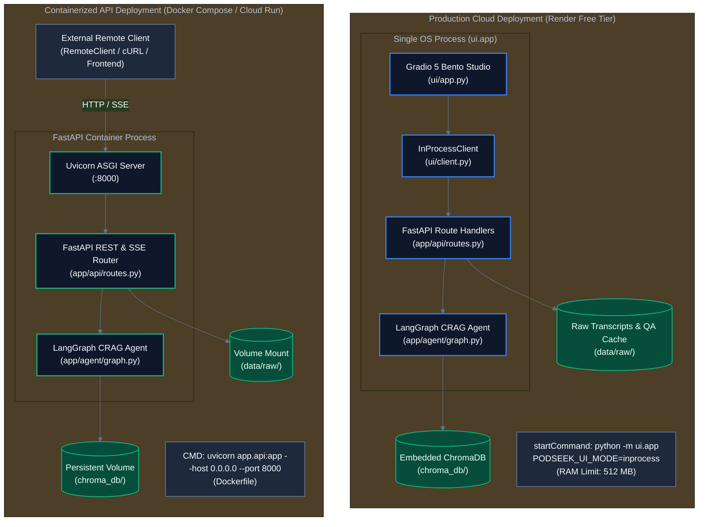

# Pillar 12: Deployment & Operations

## 1. What This Pillar Means in Production AI Systems
Deployment and operations encompasses the containerization, environment configuration, continuous integration, hosting topology, and lifecycle management that keep AI services running reliably in production. Operations must balance hosting costs, memory limits, cold-start latencies, and release verification to maintain continuous delivery without unexpected downtime or regressions.

## 2. What PodSeek Does
PodSeek supports both containerized microservice deployments and single-process cloud hosting:

- **Cloud Hosting Topology (`render.yaml`):** Deployed on Render.com free-tier web service (`podseek.onrender.com`). Uses Python 3.13 runtime, builds dependencies from `requirements.txt` and `requirements-ui.txt`, and executes `python -m ui.app`. By setting `PODSEEK_UI_MODE=inprocess`, Gradio and the agent logic run inside a single OS process, staying well within Render's 512 MB RAM limit. Configures production analytics and tracing variables (`GOATCOUNTER_CODE=podseek`, `LANGSMITH_TRACING=true`, `LANGSMITH_AGENT_ID=podseek`, `LANGSMITH_AGENT_ENVIRONMENT=production`).
- **Standalone API Container (`Dockerfile`, `docker-compose.yml`):** The repository provides a lightweight Debian-slim Python 3.13 Docker image that runs the standalone FastAPI Uvicorn server on port 8000 (`uvicorn app.api:app --host 0.0.0.0 --port 8000`).
- **Continuous Integration (`.github/workflows/ci.yml`):** Automated GitHub Actions workflow triggers on push and pull requests to `main`. Executes Ruff linter (`ruff check .`) and the 49-test Pytest suite (`pytest -v`) under Python 3.13 with `LANGSMITH_TRACING="false"` and `LANGCHAIN_TRACING_V2="false"`.
- **Branch Protection & Conventional Commits:** The `main` branch is protected, requiring all changes to pass CI and undergo PR review before merging. Commits follow conventional commit semantics (`feat:`, `fix:`, `chore:`, `docs:`).

## 3. Enterprise Approach
At enterprise scale, organizations deploy:
- **Kubernetes (EKS / GKE) & Helm Charts:** Orchestrating autoscaling agent pods with horizontal pod autoscalers (HPA) driven by incoming request queues.
- **Infrastructure as Code (IaC):** Terraform or Pulumi provisioning VPCs, managed databases, load balancers, and IAM roles.
- **Canary & Blue/Green Deployments:** ArgoCD or Spinnaker routing traffic gradually across new model releases.
- **Distributed Configuration Management:** HashiCorp Consul or AWS AppConfig providing dynamic, centralized configuration reloads without pod restarts.

## 4. Why We Didn't Need It Here, and How PodSeek Achieves the Same Intent
For a focused reference implementation and public demonstration:
- Kubernetes and Terraform add significant operational complexity completely unnecessary for a single web service.
- Render's declarative `render.yaml` blueprint provides zero-cost automated Git-push deployments with HTTPS certificates managed automatically.
- The dual-mode client design (`InProcessClient` on Render vs `RemoteClient` in Docker Compose) allows straightforward switching between zero-cost in-process hosting and production microservice containerization.

## 5. Where Our Approach Breaks Down
PodSeek's deployment architecture breaks down under the following triggers:
- **Horizontal Multi-Replica Scaling:** Scaling beyond 1 container replica breaks embedded ChromaDB and the local disk QA cache, requiring migration to an external managed vector store and Redis.
- **Traffic Spikes Exceeding 1 Concurrency:** Gradio UI events running in-process with synchronous agent steps can experience queuing under simultaneous user traffic.
- **Ephemeral Storage Loss on Free Tier:** File writes to `data/raw/` or `chroma_db/` performed at runtime on Render are lost when the ephemeral container spins down or redeploys, which is why all core data is committed to Git.

## 6. Trade-Offs Accepted
- **Free-Tier Spin-Down vs Always-Warm Concurrency:** Accepted container spin-down after inactivity (documented Render platform behavior) rather than paying for a persistent cloud instance.
- **Git-Committed Database vs External Storage:** Accepted storing the vector database in Git (72 MB in `chroma_db/`) to enable instant zero-cost deployments on ephemeral containers.
- **In-Process UI vs Microservice Separation:** Accepted in-process coupling on cloud hosting to respect the 512 MB memory ceiling.

## 7. Pitfalls Encountered
- **Render Free-Tier Memory Boundary:** Running Uvicorn and Gradio as separate processes or building vector indices on boot consumed excess RAM on 512 MB containers. Resolved in commits `986dfb1` and `826fa6e` by adopting `InProcessClient` and committing pre-built indices.
- **Dockerfile Role Confusion:** Reviewers were initially unclear whether `Dockerfile` ran the API or the UI. Clarified in commit `d4c0068` by adding explicit documentation in the Dockerfile header.

## 8. Next Steps (Candidate OpenSpec Changes)
- `multi-container-compose-profile`: Add Docker Compose profiles for running API and Gradio as separate decoupled containers locally.
- `healthcheck-readiness-probe`: Add a `/ready` health probe in FastAPI that explicitly verifies ChromaDB index connectivity before accepting traffic.
