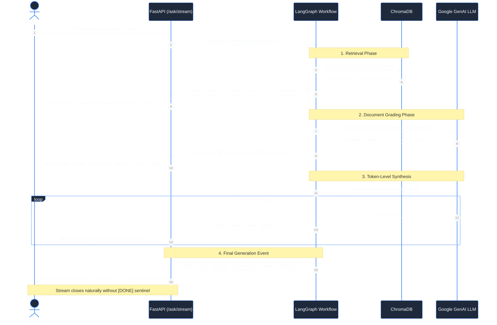

# Pillar 7: Observability & Tracing

## 1. What This Pillar Means in Production AI Systems
Observability and tracing provides deep visibility into the internal state, latency, token consumption, and decision paths of an AI agent. In production systems, observability enables rapid debugging of retrieval failures, tracks prompt/generation token distributions, records end-to-end execution spans, and powers real-time user-facing telemetry without leaking sensitive API credentials or impacting request latency.

## 2. What PodSeek Does
PodSeek implements two complementary tiers of observability: external tracing for developers and real-time streaming telemetry for end users:

- **Strict Opt-In LangSmith Tracing (`app/observability.py:configure_tracing`):** Tracing stays strictly disabled unless `LANGSMITH_TRACING=true`, a valid `LANGSMITH_API_KEY`, and both `LANGSMITH_AGENT_ID` and `LANGSMITH_AGENT_ENVIRONMENT` are provided. If any required variable is missing, `LANGSMITH_TRACING` and `LANGCHAIN_TRACING_V2` are explicitly forced to `"false"` to silence telemetry warnings during offline development. Conflicting project-level variables (`LANGSMITH_PROJECT`, `LANGCHAIN_PROJECT`, `LANGCHAIN_SESSION`) are removed.
- **Contextual Trace Configuration (`app/observability.py:trace_config`):** Injects standardized run names (`podseek_ingest` or `crag_graph`), tags (`["podseek", "crag"]` plus mode if specified), and path metadata into LangGraph and LangChain invocations under an anonymized `@traceable(name="podseek_ask", run_type="chain")` root span.
- **Server-Sent Events Real-Time Telemetry (`app/api/routes.py:iter_agent_events`):** Emits structured JSON events as each node executes (`retrieve`, `grade_documents`, `rewrite_query`, `generate`), passing retrieved chunk counts, top distance scores, rewrite counts, and structured citations.
- **Bento Studio Flowchart Spotlight (`ui/app.py`, `ui/components.py`):** The Gradio web interface consumes SSE events and dynamically updates an SVG workflow diagram in real time, spotlighting the active node (`Retrieve` -> `Grade` -> `Generate` or `Rewrite`) and rendering event log cards in a dedicated `Stats for Nerds` observability panel.

## 3. Enterprise Approach
At enterprise scale, organizations deploy:
- **Distributed APM & OpenTelemetry:** OpenTelemetry collectors forwarding spans to Datadog, Dynatrace, New Relic, or Honeycomb.
- **Dedicated LLM Tracing Platforms:** Langfuse, Arize Phoenix, Braintrust, or LangSmith enterprise with automated latency alerts, user feedback collection (thumbs up/down), and token cost aggregation dashboards.
- **Structured JSON Log Aggregation:** FluentBit or Logstash streaming application logs to an Elasticsearch or Grafana Loki cluster.

## 4. Why We Didn't Need It Here, and How PodSeek Achieves the Same Intent
For a focused podcast question-answering assistant:
- Heavy telemetry agents and OTel collectors exceed memory limits on a 512 MB container.
- PodSeek's dual-tier approach meets all needs: LangSmith provides deep nested node traces for offline developer debugging, while the custom SSE stream delivers immediate visual telemetry to end users without third-party services.
- The dual-key env check guarantees zero external trace requests during offline unit testing and automated CI.

## 5. Where Our Approach Breaks Down
PodSeek's observability breaks down under the following triggers:
- **Centralized Distributed Logging Across Replicas:** If scaled to multiple container instances behind a load balancer, SSE events and logs remain isolated to the specific instance serving the request.
- **User Feedback Collection:** The UI does not currently collect thumbs-up/down feedback or persist user ratings back to a telemetry database.
- **Historical Latency Dashboards:** Latency metrics are returned per-request in `AskResponse.latency_ms` but are not aggregated into Prometheus metrics or time-series databases.

## 6. Trade-Offs Accepted
- **Opt-In Tracing vs Always-On APM:** Accepted requiring explicit developer opt-in for LangSmith in exchange for zero configuration friction and 100% offline test cleanliness.
- **SSE Stream vs Dedicated WebSocket Telemetry:** Accepted unidirectional SSE frames over HTTP rather than maintaining bidirectional WebSocket connections.
- **Per-Request Latency vs Time-Series Aggregation:** Accepted logging latency on response objects rather than hosting a Prometheus metrics exporter.

## 7. Pitfalls Encountered
- **Noisy Tracing Errors in Offline CI:** LangChain emitted annoying warning logs in CI when `LANGCHAIN_TRACING_V2=true` was set without an API key. Fixed in commit `d4c0068` by having `configure_tracing()` explicitly force `LANGCHAIN_TRACING_V2="false"` when the key is missing.
- **SSE Documentation Discrepancy:** The README originally documented legacy `event: delta` lines and `[DONE]` sentinels that did not match the actual code implementation. Fixed in commit `d4c0068` by correcting the documentation to match the real implementation: unnamed `data: <json>` frames with token deltas.

## 8. Next Steps (Candidate OpenSpec Changes)
- `user-feedback-telemetry`: Add thumbs-up / thumbs-down buttons to the UI that log user feedback events alongside request latency in LangSmith or a local JSONL log.
- `prometheus-metrics-endpoint`: Expose a `/metrics` endpoint with Prometheus counters for request counts, rewrite distributions, and latency histograms.
