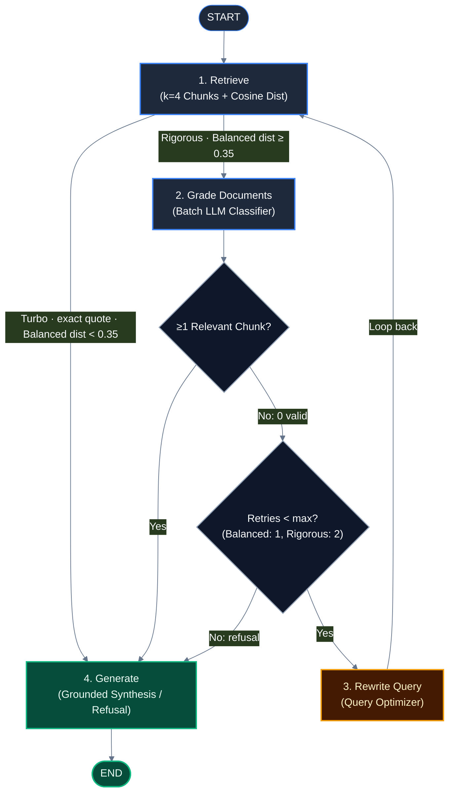

# Pillar 2: Agent Orchestration & Control Flow

## 1. What This Pillar Means in Production AI Systems
Agent orchestration defines how an AI system manages control flow across multiple reasoning, retrieval, and evaluation steps. In production environments, orchestration must guarantee termination, enforce finite resource boundaries, maintain typed state across nodes, and expose intermediate execution events for real-time frontend observability without letting the LLM wander into infinite tool-calling loops.

## 2. What PodSeek Does
PodSeek orchestrates its Corrective RAG (CRAG) pipeline using a stateful, compiled LangGraph state machine:

- **Compiled State Graph (`app/agent/graph.py:build_graph`):** The workflow defines four nodes (`retrieve`, `grade_documents`, `rewrite_query`, `generate`) operating on a strongly typed `AgentState` schema (`app/agent/state.py`).
- **Post-Retrieval Router (`app/agent/graph.py:route_after_retrieve`):** Evaluates whether to proceed directly to `generate` (fast-path for Turbo mode, exact quote matches, or Balanced mode with $top\_distance < 0.35$) or route to `grade_documents`. Because Turbo mode unconditionally bypasses `grade_documents`, it never encounters the retry loop, making its `max_retries = 0` branch in `decide_to_generate` unreachable; Turbo refusals rely entirely on the prompt instructions within `generate`.
- **Decision Router (`app/agent/graph.py:decide_to_generate`):** Checks if `relevant_documents` is populated. If empty, it inspects `rewrite_count` against mode-specific retry bounds: 1 for Balanced and 2 for Rigorous (`MAX_REWRITES = 2`).
- **Loop Bounds & Circuit Breaker (`app/agent/graph.py`):** If `rewrite_count >= max_retries`, the graph breaks the loop and forces routing to `generate`, which is contractually bound to issue a refusal rather than continuing to search.

## 3. Enterprise Approach
At enterprise scale, agent systems frequently employ:
- **Distributed Workflow Engines:** Temporal.io, AWS Step Functions, or LangGraph Cloud with persistent PostgreSQL/Redis checkpointing, durable execution, and human-in-the-loop intervention pauses.
- **Dynamic Multi-Agent Swarms:** Specialized routing agents (e.g. supervisor agents directing specialized sub-agents for web search, document retrieval, and SQL generation) operating over dynamic message buses.
- **Autonomous Tool Selection:** Open-ended ReAct or function-calling loops where the LLM decides its own stopping criteria dynamically.

## 4. Why We Didn't Need It Here, and How PodSeek Achieves the Same Intent
For a focused podcast question-answering assistant:
- Free-form autonomous agent loops introduce non-deterministic latency and runaway token costs when queries are out of domain.
- LangGraph's compiled `StateGraph` provides complete structural determinism: every valid path through the graph is statically known at compile time.
- In-memory execution without distributed checkpointing eliminates the need for an external Redis or Postgres instance on Render's 512 MB free tier.

## 5. Where Our Approach Breaks Down
PodSeek's orchestration breaks down under the following triggers:
- **Multi-Turn Conversational Memory:** The current graph operates on a single stateless turn (`AgentState["question"]`), meaning follow-up questions ("What else did he say about that?") require re-stating the subject.
- **Multi-Modal or Multi-Tool Expansion:** Adding web search, user calculators, or audio clip playback would require hardcoding new branches or transitioning to a multi-agent routing architecture.
- **Long-Running Async Workflows:** Without persistent checkpointing, if a container restarts mid-execution, in-flight queries are lost.

## 6. Trade-Offs Accepted
- **Static Graph Topology vs Dynamic Tooling:** Accepted fixed routing edges in exchange for zero runaway loops and guaranteed termination.
- **Single-Turn State vs Multi-Turn History:** Accepted ephemeral single-query sessions to avoid maintaining session database storage on free-tier infrastructure.
- **Strict Hardcoded Retry Limits:** Accepted a maximum of 2 query rewrites rather than dynamically calculating retry budgets based on remaining latency SLAs.

## 7. Pitfalls Encountered
- **Deterministic Loop Termination:** The circuit breaker was introduced alongside the LangGraph state machine in commit `a57c9ce`, enforcing `MAX_REWRITES = 2` to mathematically guarantee loop termination rather than relying on open-ended model self-direction.
- **Redundant Grading on Exact Matches:** When a user searched for an exact quote, the system still executed batch LLM grading until commit `9a36aea` introduced `route_after_retrieve` to bypass grading and fast-path to generation.

## 8. Next Steps (Candidate OpenSpec Changes)
- `multi-turn-memory`: Introduce a thread-scoped checkpointer to support multi-turn conversational follow-ups with contextual query reformulation.
- `adaptive-retry-budget`: Dynamically adjust allowable rewrite retries based on upstream API rate-limit headers and client timeout deadlines.
